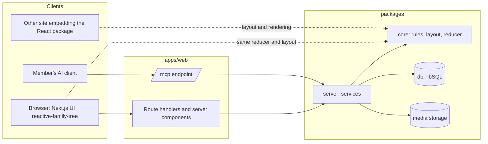
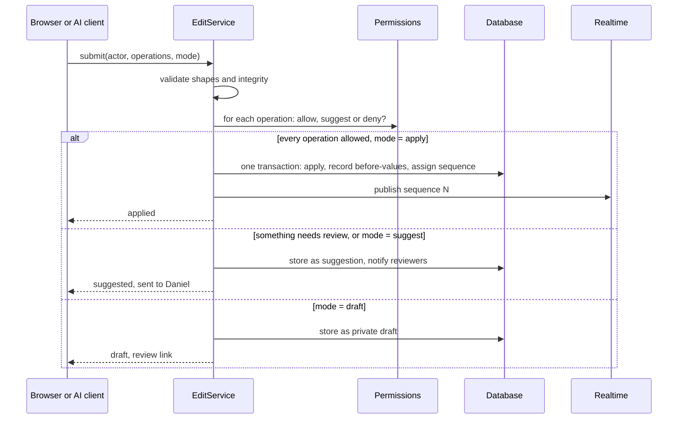

# 05 Architecture

## Shape

A monorepo. All logic lives in framework-free packages. The apps are thin shells around them. This keeps the React package usable anywhere, lets the MCP server and the web UI share one write path, and makes the choice of app framework reversible.

```
reactive-family-tree/
├─ apps/
│  ├─ web/                 Next.js app: tree, person pages, sign-in, admin, API, MCP endpoint
│  └─ site/                Astro: landing page, live demo, documentation
├─ packages/
│  ├─ core/                Types, schemas, graph, kinship, fuzzy dates, layout engine,
│  │                       branch geometry, edit reducer, permission rules. No DOM, no I/O
│  ├─ react/               Published as `reactive-family-tree`: <FamilyTree>, camera,
│  │                       gestures, themes, accessibility, server SVG rendering
│  ├─ db/                  Drizzle schema, migrations, libSQL client, queries
│  ├─ server/              Services: edits, permissions, privacy, media, import/export,
│  │                       notifications, realtime. Storage and email adapters
│  ├─ mcp/                 MCP server (tools, resources, prompts), HTTP handler, stdio bridge
│  ├─ gedcom/              GEDCOM 5.5.1 and 7 parser and writer
│  └─ demo-data/           A fictional family used by tests, stories, the demo and docs
├─ docs/                   These plans
└─ docker/                 Dockerfile, compose file
```



The important property: **the browser UI, the MCP server, the REST API and GEDCOM import all call the same `EditService.submit()`**. There is exactly one place where a change is validated, permission-checked, recorded and applied.

In the first build that function is `Edits.submit()` in `packages/server`. Two things sit somewhere other than the tree above says. The layout and drawing engine lives whole in `packages/react`, carried over from the demo as one piece, and has not yet been split into `core`. And the family is held in memory on the server and written to typed tables in one transaction per edit, which is simple and fast at a family's size.

## Stack

Versions are "latest stable when the phase starts", pinned in the lockfile.

| Concern | Choice | Why |
|---------|--------|-----|
| Language | TypeScript 6, strict | One language across packages, apps and MCP. Held at 6 until the lint tooling supports 7 |
| Monorepo | pnpm workspaces, Turborepo | Fast, standard, cached builds |
| App | Next.js 16 (App Router), React 19 | Server rendering for public pages, route handlers for API and MCP, View Transitions |
| Project site | Astro with Starlight | Near-zero JavaScript pages, first-class docs, React islands for the live demo |
| Database | libSQL through Drizzle | A single file when self-hosted, Turso when serverless, same code. Recursive queries and full-text search built in |
| Auth | Better Auth with its MCP plugin | Magic links, passkeys, social sign-in, and an OAuth server for MCP clients, all in our own database |
| MCP | Official TypeScript SDK v2 (`@modelcontextprotocol/server`) | Stateless web-standard handler that mounts in a route handler |
| Validation | Zod | One schema per operation, shared by UI, API and MCP tool definitions |
| Styling | Plain CSS with custom property tokens: `tree.css` in the React package, `app.css` in the app | Tokens drive both the interface and the SVG. These are the approved demo's stylesheets, carried over so the app looks exactly like it. Tailwind was planned and dropped |
| Interface primitives | Our own small components: drawer, menus, ring menu, card | The demo's markup and keyboard behaviour, kept as they were approved. Base UI was planned and dropped |
| Animation | Motion, CSS, Web Animations API | See [03](03-motion-and-svg.md) |
| Client state | A small external store in the React package, TanStack Query in the app for detail data | The tree store must work without the app |
| Images | sharp | Thumbnails, re-encoding, metadata stripping |
| Email | Adapter: SMTP or Resend | Self-hosters choose |
| Media storage | Adapter: local disk or any S3-compatible bucket | Same reason |
| Tests | Vitest, fast-check, Playwright, axe | Unit, property, end-to-end, accessibility |
| Workshop | Storybook for the React package | Every state and effect in isolation, with visual snapshots |
| Releases | Changesets (the npm release tool), GitHub Actions | Versioned packages and a changelog |

A naming note: the npm release tool is called Changesets. To avoid confusion, the product's own unit of change is always called an **edit**.

## The core package

Pure functions and types, runnable in the browser, on the server, in a worker and in tests.

- `schema`: Zod schemas and types for every entity and every operation.
- `graph`: build an in-memory graph from people, unions and links. Ancestors, descendants, branch scope, cycle detection.
- `kinship`: the path between two people and its name ("second cousin once removed"), with localisable terms.
- `dates`: parse, format, compare and sort fuzzy dates.
- `reducer`: `applyOps(state, ops) -> state`. Used by the server to validate, and by the browser for instant updates and for applying other people's edits.
- `permissions`: `canApply(actor, op, graph) -> allow | suggest | deny`. The same rule runs in the browser (to show the right affordance) and on the server (to enforce it).
- `validate`: integrity rules (nobody is their own ancestor, death after birth) returning errors and warnings.
- `layout`: the layout engine below.
- `geometry`: tapered branch outlines, foliage hulls, ring positions.

## Layout engine

Input: the graph, a view, a focus, the set of expanded branches, and style parameters. Output: positions and shapes in world coordinates, independent of zoom.

1. **Choose a spanning tree.** A family is a graph, not a tree. Within one tree each person gets exactly one position: as a child in their primary birth union if that union is in this tree, otherwise beside their partner as a graft. Each union has a host partner (see "Which family a couple is drawn with" in [02](02-visual-design.md)), and the couple and their children are placed at the host's position. If both partners are descendants in the same tree (a cousin marriage), each stays at their own birth position, the children hang from the host, and a vine joins the other partner to the union. A child with a second, non-primary union (for example an adoptive and a birth family) gets a vine to the second.
2. **Build family units.** A unit is a person with their partners in order of union date. A unit is laid out as one block, with a blossom between each pair.
3. **Tidy tree.** A linear-time tidy tree algorithm (Buchheim and Walker's refinement of Reingold and Tilford) runs over the units, with collapsed subtrees as single bud nodes. Siblings are ordered by birth date, then by a stable order hint, then by id, so the result never shuffles between renders.
4. **Roots.** In Roots view, ancestors are laid out as a mirrored binary tree below the focus unit. Repeated ancestors are drawn once with a vine.
5. **Shape the crown.** Positions are warped slightly so the canopy forms a dome instead of flat tiers. A single "tidy to wild" parameter from 0 to 1 controls this and the branch wobble. At 0 the result is a clean, classic generational chart.
6. **Widths.** Each link gets start and end widths from the number of people it carries.
7. **Emit.** Nodes (people, blossoms, buds, foliage masses), links with widths and seeds, vines, bounds, and a spatial index for finding what is on screen.

Properties, enforced by property-based tests on random families:
- No two nodes overlap.
- The same input always gives the same output.
- Partners are adjacent. Children are centred under their union.
- Expanding or collapsing one branch never reorders any other.
- 10,000 people lay out in under 100ms. Above 2,000 people the engine runs in a web worker.

A person's lineage is found by walking up: from the person to their primary birth union, to that union's host partner, and so on until someone with no recorded parents. That founder (or founding couple) names the lineage. It is derived, cached on the person, and recomputed when links or hosts change. The admin can pin a lineage's name, species and colour.

The Grove view runs the layout once per lineage, stopping each tree at people whose lineage is a different one (they appear as a leaf with a graft band, and their descendants are drawn only in their own lineage's tree). The trees are packed along a ground line, largest in the middle, with graft lines between them. A lineage appears as its own tree when it has at least three people or the admin pins it.

Orientation (grow up, grow down, sideways) is a final transform, so the algorithm itself only ever thinks top-down.

## The React package

```tsx
import { FamilyTree } from "reactive-family-tree";

<FamilyTree
  data={{ people, unions, links }}
  view="canopy"
  focus="p_01H..."
  viewerId="p_01J..."
  theme={botanical}
  onSelect={(person) => {}}
/>
```

- Controlled or uncontrolled for view, focus, selection, expanded branches and camera.
- Slots for the leaf, the card and the label, so a host can replace any of them.
- Hooks for people who want pieces: `useTreeLayout`, `useCamera`, `useKinship`.
- `renderToSVG(data, options)` returns a static SVG string on the server, used for no-JavaScript rendering, social images and posters.
- Editing gestures are opt-in and raise events. The package never talks to a server.
- A theme interface: tokens, symbol library, link renderer, ambient layer, motion presets.
- Peer dependencies: React and Motion. Target size: under 60KB compressed for the default theme.

## Data flow in the app

**Reading.** The server sends a compact snapshot of the whole tree (ids, names, years, state, portrait thumbnails, unions, links) stamped with a sequence number. It is built in three layers:

- **Visitor snapshot**, shared and cached: only what the public may see. Masked people are anonymous placeholders with throwaway ids.
- **Member snapshot**, shared and cached: everything at `public` and `members` level. People marked `private` are placeholders here too.
- **Personal overlay**, per viewer and small: the `private` people this viewer is entitled to (their own leaf, their branches, or everything for admins), plus the pending items they may see (their own drafts and suggestions, and suggestions waiting for their review).

Both shared snapshots are rebuilt when the sequence advances. Full detail for a person (facts, story, media, sources, history) loads when their card opens and is permission-checked per request, including fact-level privacy. For very large trees the snapshot is split by lineage and loaded as lineages come into view.

**Writing.**



The browser applies its own edit to the local store immediately using the shared reducer, then reconciles when the server answers. If the server says "suggested" instead of "applied", the new leaf turns to pencil.

**Realtime.** Every applied edit has a sequence number. Clients sync with one rule: "give me what changed after sequence N". What comes back depends on who asks:

- **Members** receive the operations themselves and replay them through the shared reducer, which is what makes growth appear live. Any operation that touches something the member may not see is replaced by a bare "refetch this person" marker, or dropped if they may not know the person exists.
- **Visitors** never receive operations. They receive only "the tree changed", and refetch the visitor snapshot. Nothing masked can leak through the feed because nothing is in it.

A server-sent event stream tells clients that a new sequence exists. Where long-lived streams are not available (some serverless hosts), clients poll the same cursor endpoint every few seconds. Nothing depends on the stream for correctness. Presence (who is viewing which branch) is a lightweight heartbeat on the same channel, members only, and best-effort.

## Storage and deployment

| Mode | Database | Media | Realtime | How |
|------|----------|-------|----------|-----|
| Self-hosted | A libSQL file on a volume | Local folder on the same volume | Server-sent events | `docker run -v data:/data -p 3000:3000 …` |
| Serverless | Turso | S3-compatible bucket | Polling, stream where supported | One-click deploy template |

- **The self-hosted container is the reference target** and has every feature. Serverless is supported with the differences listed here, and anything that cannot work there is said so in the admin area instead of failing silently.
- One container runs the app. No separate database, queue or cache service is required.
- **Scheduled work** (nightly snapshot, compost purge, digests, review reminders) is a set of idempotent jobs behind one scheduler interface. In the container an in-process timer runs them. On serverless the host's cron calls an authenticated endpoint that runs whatever is due.
- Configuration through environment variables is limited to secrets and infrastructure: base URL, auth secret, database URL, storage and email credentials. Everything else is set in the UI and stored in the database.
- First start with an empty database prints a one-time setup link to the server log (and accepts a `SETUP_TOKEN` variable for hosts without log access). Only that link opens the setup wizard, so a stranger who finds a fresh install cannot claim it.
- Migrations run automatically on start. In the container the database file is copied first. On serverless the provider's point-in-time recovery is the safety net, and the docs say to confirm it is enabled.
- A nightly snapshot (a full export) is written to media storage, keeping the last 14. An admin can download a full zip (export plus media) at any time.
- A health endpoint reports database, storage and email status for uptime monitors.

## Security

- Every permission and privacy rule is enforced in the server package. The browser's copy of the rules only decides what to show.
- Session cookies are HTTP-only and same-site. State-changing requests check origin.
- Personal tokens are stored hashed, shown once, scoped, expiring and revocable.
- The MCP endpoint validates host and origin, verifies the token's audience, and applies the same per-user rate limits as the API. See [09](09-mcp-and-api.md).
- Uploads are size-limited, type-checked by content, re-encoded, and stripped of location metadata.
- Stories and memories are Markdown, rendered through a sanitiser. No raw HTML.
- A strict content security policy. No third-party scripts in the app.
- Rate limits on sign-in, invites, suggestions from visitors, and uploads.
- Dependency and secret scanning in CI, and a documented way to report vulnerabilities.

## Testing

| Layer | Tooling | What is proven |
|-------|---------|----------------|
| Core | Vitest, fast-check | Layout invariants on random families, kinship terms, date parsing, the reducer, every permission rule as a table of cases |
| Services | Vitest against a temporary libSQL file | Edit pipeline, suggestions, three-way merge on approval, revert, privacy filtering, import and export round-trips |
| MCP | SDK client over an in-memory transport | Each tool's contract, permission outcomes per role, draft mode, error shapes |
| React package | Storybook, visual snapshots, Playwright | Every leaf state and effect, gestures with emulated touch, keyboard paths, frame-time budgets |
| App | Playwright | The journeys: set up, invite, claim a leaf, add a family, suggest and approve, connect an AI token, export |
| Accessibility | axe in Playwright, manual screen reader pass | No violations on any screen, full keyboard operation |
| Performance | Scripted pans on a throttled profile | The budgets in [03](03-motion-and-svg.md), tracked per commit |

The demo family in `demo-data` has around 400 people across three lineages and includes every awkward case on purpose: several marriages, adoption, a cousin marriage, unknown parents, uncertain dates, twins, names in three scripts. A generator produces families of 5,000 and 20,000 for performance tests.

## Internationalisation

- Interface strings in ICU message format, English and Hebrew in v1.
- Logical CSS properties throughout, so right-to-left needs no special cases.
- Names are stored per script, and each viewer can choose which script to show first.
- Dates are formatted for the viewer's locale from the stored fuzzy date. Kinship terms come from per-language rule files in core.
