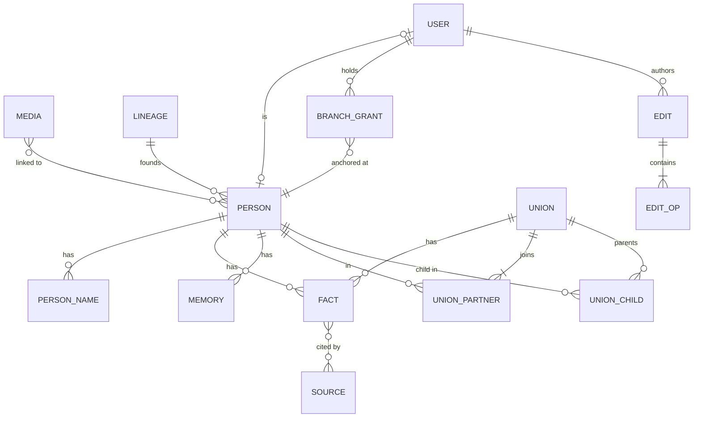

# 06 Data model

The model is built around how families actually are: several partners, adoption, unknown parents, dates nobody is sure of, names in more than one alphabet. It maps cleanly to and from GEDCOM so nobody is locked in.

## Entities at a glance



Ids are prefixed, sortable and unguessable: `p_` person, `u_` union, `f_` fact, `s_` source, `m_` media, `e_` edit, `usr_` user. Every editable row has a `rev` number that increases on each change, and a `deleted_at` for compost.

## People

**person**

| Column | Notes |
|--------|-------|
| `id`, `rev` | |
| `sex` | `female`, `male`, `other`, `unknown`. Optional. Affects only kinship words |
| `living` | `yes`, `no`, `unknown`. When unknown, a rule decides (see privacy in [07](07-roles-editing-and-review.md)) |
| `privacy` | `default`, `public`, `members`, `private` |
| `public_consent_by`, `public_consent_at` | Set only when a living person opts in to being public, and only by that person's own account |
| `lineage_id` | Derived by walking up through host partners (see [05](05-architecture.md)). Cached |
| `portrait_media_id` | |
| `bio` | Markdown |
| `slug` | For readable person page addresses |
| `birth_sort`, `death_sort` | Integers derived from facts, for ordering and the year slider |

**person_name.** A person has one or more names.

| Column | Notes |
|--------|-------|
| `kind` | `birth`, `married`, `known_as`, `religious`, `other` |
| `given`, `family`, `prefix`, `suffix` | |
| `script`, `lang` | For example `Latn`/`en`, `Hebr`/`he`, `Cyrl`/`ru` |
| `is_primary` | One primary per script |
| `search_key` | Lower-cased and transliterated for matching across scripts |

## Families

**union.** A partnership. Children attach to a union, not to two separate parents, because that is how both the layout and people's thinking work.

| Column | Notes |
|--------|-------|
| `kind` | `marriage`, `partnership`, `unknown` |
| `status` | `current`, `ended`, `unknown` |
| `host_person_id` | The partner whose branch the couple and their children are drawn on |

**union_partner**: `union_id`, `person_id`, `position`. One or two partners. A union with one partner models a child with one known parent.

**union_child**: `union_id`, `child_id`, `kind` (`birth`, `adopted`, `step`, `foster`, `unknown`), `is_primary`, `order_hint`. A child may belong to more than one union, for example a birth family and an adoptive family. The primary one decides where the leaf is drawn. The other is drawn as a vine.

**lineage**: `name`, `founder_union_id` or `founder_person_id`, `species`, `colour`, `pinned`. Created automatically for founders and adjustable by the admin.

## Facts, sources and media

**fact.** Everything that happened is a fact attached to a person or a union.

| Column | Notes |
|--------|-------|
| `subject_type`, `subject_id` | Person or union |
| `type` | `birth`, `death`, `burial`, `marriage`, `divorce`, `residence`, `occupation`, `education`, `immigration`, `military`, `religion`, `custom` |
| `date` | A fuzzy date (below) |
| `date_sort` | Integer, earliest possible day |
| `place_id`, `place_text` | Normalised place when known, and the text as entered |
| `value`, `note` | For example the occupation, and free notes |
| `certainty` | `certain`, `probable`, `uncertain` |
| `privacy` | Facts can be more private than their person (for example a cause of death) |

**place**: `name`, `parts` (village, city, region, country), `lat`, `lng`, all optional.

**source**: `title`, `kind` (certificate, census, book, interview, website, photo), `url`, `repository`, `citation`, `media_id`. Joined to facts through **fact_source** with an optional page and quote.

**media**: `kind` (image, document, audio, video), `storage_key`, `mime`, dimensions, `blurhash`, `caption`, `date`, `uploaded_by`, `privacy`. Joined through **media_link** to a person, union or fact with a `role` (`portrait`, `gallery`, `evidence`) and an optional region for a face in a group photo.

**memory**: a short piece written by a relative about a person. `person_id`, `author_user_id`, `body` (Markdown), optional media, `privacy`.

## Fuzzy dates

Family history is full of "about 1890". Dates are stored as what is actually known.

```json
{ "kind": "exact",   "from": "1921-03-04" }
{ "kind": "exact",   "from": "1921" }
{ "kind": "about",   "from": "1890" }
{ "kind": "before",  "from": "1914-08" }
{ "kind": "after",   "from": "1945" }
{ "kind": "between", "from": "1921", "to": "1922" }
{ "kind": "or",      "from": "1921", "to": "1922" }
```

- Precision is whatever was given: a year, a month or a day.
- `calendar` is optional (`gregorian` by default, with `julian` and `hebrew` supported) and `text` keeps the original wording when it was imported.
- The interface accepts natural typing ("abt 1890", "March 1921", "before the war" stays as text) and shows it back in plain words.
- Every kind maps to a GEDCOM date phrase and back without loss.

## Accounts and access

**user** (managed by the auth library, extended): `person_id` (the leaf they are), `role` (`owner`, `admin`, `member`), `locale`, `preferred_script`, `comfort_mode`, `last_seen_seq`.

**branch_grant**: `user_id`, `anchor_person_id`, `granted_by`. A user with at least one grant is a steward of those branches.

**invite**: hashed token, `email`, `role`, `person_id` to claim, `anchors` to grant, `expires_at`, `used_at`.

**ai_connection**: one row per connected AI client, however it signed in. `user_id`, `name`, `client_name`, `kind` (`oauth`, `token`, `bridge`), a reference to the OAuth grant or the personal token, `mode` (`review_first`, `apply_directly`), `access` (`read`, `read_write`, `admin`), `tool_profile` (`full`, `simple`), `last_used_at`, `revoked_at`. The settings on the "Connect your AI" screen live here, so they work the same for sign-in connections and token connections.

**api_token**: hashed token, `user_id`, `name`, `expires_at`. Used by AI connections of kind `token` and by REST API scripts.

**contact**: a visitor who is not a member but has confirmed an email address: `email`, `name`, `verified_at`. Lets visitors make suggestions and requests without an account.

**join_request**: `contact_id`, who they say they are, an optional `person_id`, `status`, `decided_by`.

**change_request**: a "request a change or removal" sent from a public page: `contact_id`, `person_id`, `message`, `status`, `handled_by`.

**notification**: `user_id`, `kind`, a reference to its subject, `read_at`, `emailed_at`. Each user's notification choices (immediate, digest, off, per kind) are stored on the user.

**setting**: key and JSON value for everything the admin configures.

OAuth clients, grants and sessions are stored in the auth library's own tables.

## Edits: the single write path

Every change from every source is an edit.

**edit**

| Column | Notes |
|--------|-------|
| `id` | |
| `seq` | Assigned when applied. The global order of history |
| `author_user_id` | Empty for a visitor's suggestion |
| `author_contact_id` | Set for a visitor's suggestion |
| `origin` | `ui`, `mcp`, `api`, `import`, `system` |
| `ai_connection_id` | For MCP: which connection made it |
| `message` | A short human note: "Added Noa's children" |
| `status` | `draft`, `suggested`, `applied`, `declined`, `withdrawn`, `reverted` |
| `reviewed_by`, `review_note` | |
| `reverts_edit_id` | Set when this edit undoes another |

**edit_op**: `edit_id`, `idx`, `type`, `target_type`, `target_id`, `payload`, `before`, `base_rev`.

**edit_comment**: a short thread between reviewer and author on a suggestion.

### Operations

| Group | Operations |
|-------|------------|
| Person | `person.create`, `person.update`, `person.remove`, `person.restore`, `person.merge` |
| Name | `name.add`, `name.update`, `name.remove` |
| Union | `union.create`, `union.update`, `union.remove`, `union.add_partner`, `union.remove_partner` |
| Children | `child.link`, `child.unlink`, `child.update` |
| Fact | `fact.add`, `fact.update`, `fact.remove` |
| Source | `source.add`, `source.update`, `source.attach`, `source.detach` |
| Media | `media.attach`, `media.detach`, `media.update` |
| Memory | `memory.add`, `memory.remove` |
| Lineage | `lineage.update` |

An edit can create several things and connect them in one go using temporary references:

```json
{
  "message": "Add Maya, daughter of Noa and Eitan",
  "ops": [
    { "type": "person.create", "ref": "$maya",
      "names": [{ "given": "Maya", "family": "Cohen", "script": "Latn" }],
      "sex": "female", "living": "yes" },
    { "type": "fact.add", "subject": "$maya", "factType": "birth",
      "date": { "kind": "exact", "from": "2026-10-02" }, "placeText": "Haifa" },
    { "type": "child.link", "union": "u_01HX...", "child": "$maya", "kind": "birth" }
  ]
}
```

### Drafts can change, submitted edits cannot

A draft belongs to its author and can be changed freely: values corrected, operations removed. When the author applies only some of a draft, the chosen operations are moved into a new edit (together with anything they depend on, such as the creation of a person whose fact was chosen) and the rest stay in the draft. Once an edit is submitted, as applied or as a suggestion, it is atomic and fixed: all of it happens or none of it does.

### Applying an edit

One database transaction:

1. Validate every operation's shape.
2. Run it through the shared reducer on the current graph. Collect integrity **errors** (block the edit) and **warnings** (returned to the author and shown to reviewers).
3. Ask the permission rules about each operation. See [07](07-roles-editing-and-review.md) for outcomes.
4. If applying: write the rows, increase each `rev`, store each operation's `before` values, assign the next `seq`, update the search index.
5. Publish the new sequence number to connected clients.

Integrity rules:

| Rule | Level |
|------|-------|
| Nobody is their own ancestor | Error |
| Death is not before birth | Error |
| A union has at most two partners | Error |
| A parent is born before their child | Warning |
| A parent is between 12 and 80 at a child's birth | Warning |
| A lifespan is under 125 years | Warning |
| A new person closely matches an existing one (name and birth year within two) | Warning, with a "same person?" prompt |

### History, undo and conflicts

- **History.** Every person page has a history tab: who changed what, when, from where, with before and after. AI-originated edits carry a small mark and the client's name.
- **Undo.** Reverting an edit creates a new edit made of the inverse operations, built from the stored `before` values. History is never rewritten.
- **Conflicts on revert.** If a later edit changed the same field, the revert shows both values and asks which to keep.
- **Conflicts on approval.** A suggestion remembers the `rev` it was based on. If the target has changed since, approval performs a field-by-field three-way merge and shows only the fields that truly clash.
- **Compost.** Removal sets `deleted_at`. Removed items are hidden everywhere, restorable for 30 days, then purged by a daily job. Purging is recorded.
- **Merging duplicates** moves names, facts, media, unions and children onto the kept person and records enough to split them again.

## Search

A full-text index over every name in every script, the transliterated search keys, places and years. It uses trigram matching, so "Chananaev", "Khananaev" and "חננייב" find the same people. Results are filtered by the viewer's privacy rights before they leave the server.

## Import and export

| Format | In | Out | Notes |
|--------|----|-----|-------|
| GEDCOM 5.5.1 | Yes | | The format most existing software produces |
| GEDCOM 7 | Yes | Yes | With media in a zip |
| Full backup | Yes | Yes | A zip of JSON for every table plus all media. Restoring replaces the whole tree with an identical copy of the backup. Owner only, and a snapshot of the current state is taken first |
| Poster | | Yes | SVG and PDF |
| Person page | | Yes | Print stylesheet |

A GEDCOM import never writes directly. It produces a staged edit: the admin sees a preview on the tree (new leaves in pencil), a list of likely duplicates to merge, and anything the importer could not understand, then applies it as one revertible edit.
