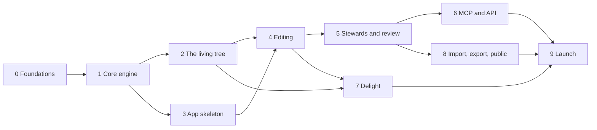

# 11 Roadmap

The work is ordered so that the most impressive and most reusable thing (the living tree) exists early and in public, and so that every later phase builds on a tested base. Each phase ends in something that can be shown.

Sizes are relative: S is days, M is a week or two, L is several weeks, for one experienced developer working with an AI assistant. They are for ordering, not promises.

## Where the build stands

A first full build exists (November 2026). Its scope was set as "everything the demo does, on the real stack", so it cuts across the phases below instead of finishing them one by one.

**Built and tested**

- The monorepo, strict TypeScript, linting, CI, the Docker image, the licence and the community files.
- `core`: people, partnerships, facts, fuzzy dates, the edit reducer, permissions, privacy, validation and kinship.
- The living tree as the `reactive-family-tree` React component, with the engine, gestures, light and dark, the phone layout and reduced motion exactly as approved in the demo.
- The app on Next.js: typed tables on libSQL, sign-in by emailed link, passkey and optional Google, invitations by email, the setup link and wizard, editing, suggestions and review, undo, drafts, the compost, members and branches, health, settings, live updates, GEDCOM and backup in and out, and daily jobs.
- MCP with the official SDK: sign-in from the AI client or a personal token, the tools, resources and prompts, "review first" by default.
- Public person pages with structured data, a sitemap, and no indexing for a private tree.
- The Astro site: a landing page with a live tree, and the documentation.

**Still to come, as planned below**

- Photos, galleries and sources (phase 4 and 7).
- Several names per person, and Hebrew with right-to-left layout (phase 4 and 9).
- The Roots, Rings, Grove and Outline views, and the layout engine moved into `core` (phase 1 and 2).
- The extra gestures: swiping a card to the next sibling, dropping a bud on someone to connect two people, selecting several, redo (phase 7).
- Choosing field by field when an undo conflicts, and merging duplicates side by side (phase 5 and 8).
- The local bridge for AI clients that only speak over standard input and output (phase 6).
- Storybook, browser tests with Playwright and axe, property-based tests, and versioned releases to npm (phase 0 and 9).

## Phase 0: Foundations (S)

- Monorepo with pnpm and Turborepo, strict TypeScript, linting, formatting, Vitest, Playwright.
- CI: type check, lint, test on every pull request.
- Design tokens (colour, type, spacing, timing) as CSS custom properties and a TypeScript export.
- The fictional demo family, hand-written, with every awkward case. A generator for large random families.
- License, readme, contribution guide, code of conduct, security policy.

Done when: a fresh clone installs and passes CI with one command, and the demo family loads as typed data.

## Phase 1: Core engine (M)

- Schemas and types for every entity and operation.
- Graph building, ancestors, descendants, branch scope, cycle detection.
- Fuzzy dates: parse, format, sort.
- The reducer and the integrity rules.
- Kinship paths and English terms.
- The layout engine: spanning tree, family units, tidy tree, roots, crown shaping, widths, spatial index.
- Branch geometry: tapered outlines with seeded wobble, foliage hulls.

Done when: property tests hold the layout invariants on thousands of random families, 10,000 people lay out in under 100ms, and a script writes a static SVG of the demo family that already looks like a tree.

## Phase 2: The living tree (L)

The React package, built in the Storybook workshop.

- Static rendering of branches, leaves, blossoms, buds, labels. Species library (four species to start). Day and night palettes.
- Camera: pan, pinch, wheel, momentum, bounds, fly-to. The gesture recogniser.
- Zoom levels: foliage masses, leaves, portraits. Drawing only what is on screen.
- Growth: expand, collapse, first load.
- Selection, the person card, the shared portrait transition.
- Canopy and Roots views and the journey between them.
- Wind, moving-quality switch, reduced motion, quality ladder.
- Keyboard navigation and screen reader labels. The Outline view.
- Server rendering to an SVG string.
- The theme interface.
- A first Astro site: home page with the live demo running in the browser, and package docs.

Done when: the demo family runs at 60 frames per second on a mid-range phone, the interactions in [04](04-gestures-and-interaction.md) under "Exploring" work by touch, pointer and keyboard (except the year slider, the relationship finder, and the Rings and Grove views, which arrive in phase 7), accessibility checks pass, and `reactive-family-tree` is published as a first pre-release with the demo live on the site.

**This is the first public moment.** The tree alone, with a demo, is worth sharing.

## Phase 3: App skeleton (M)

- Next.js app with the database package, migrations, and the service layer.
- Sign-in: magic link, passkeys, Google. Sessions.
- The one-time setup link and the setup wizard.
- A basic invitation by link or email that creates a member account. Tying invitations to a leaf, roles and branches come in phase 5.
- The scheduler interface with its two drivers (in-process, and an endpoint for a host's cron).
- Reading: snapshot endpoint, privacy filter, the explorer on real data, person pages, search.
- Media upload and storage adapters, portraits.
- Docker image and compose file.

Done when: `docker run` leads through the wizard to a private tree with one person, a second invited account can sign in and browse, and a visitor sees only the sign-in page.

## Phase 4: Editing (L)

- The edit service: validate, check, apply, record, sequence.
- Edit mode: bud handles, pulling a twig, relationship zones, connect by dropping, the quick form on a new leaf.
- Fact editing in place, names in several scripts, fuzzy date input, story editor, gallery.
- Instant local updates with the shared reducer, reconciliation with the server.
- History tab, undo and redo, compost and restore.
- The sync feed and live growth on other screens.

Done when: on a phone, a family of five is added in under two minutes, every change appears on a second device within two seconds, every change can be undone, and an integrity error explains itself in plain words. Permissions at this stage: owner and admin edit everything.

## Phase 5: Stewards and review (L)

- Roles, branch grants, scope in core, enforced in the service layer.
- Invitations tied to a leaf, claiming a leaf, requests to join, reunion codes.
- Suggestions: "Something wrong?", pencil leaves and margin notes, my suggestions.
- The review inbox: approve, edit and approve, decline, ask, bulk, three-way merge.
- Notifications in app and by email, digests.
- The admin area: Members, Branches (painting on the tree), Activity, Tree health, Settings.
- Privacy levels, the living rule, masking for visitors, public mode.
- Presence.

Done when: the permission table in [07](07-roles-editing-and-review.md) passes as an automated test for every role and location, a steward's edit outside their branch arrives in the right inbox and can be approved from a phone, and a crawl of a public tree as a visitor finds no living person's details.

## Phase 6: MCP and API (M)

- The MCP package: tools, resources, prompts, instructions, schemas from the shared definitions.
- Mounting at `/mcp` with the SDK handler. OAuth through the auth library's MCP plugin. Personal tokens.
- Draft mode end to end: pencil growth preview, the review panel, apply selected.
- The "Connect your AI" screen with per-client setup, connections, modes, revoke.
- The local bridge with device sign-in.
- Rate limits, AI-assisted marks in history, admin controls and alerts.
- The REST API and its OpenAPI description.

Done when: three different AI clients connect by sign-in with no token copied, "add my wife's parents and her two brothers" produces a correct draft that is applied with one tap, the same request from a member with no rights there becomes a suggestion, a contract test covers every tool for every role, and a small local model completes the basic journey with the simple tool set.

## Phase 7: Delight (M)

Can run alongside phases 5 and 6.

- The year slider and time-lapse.
- Rings view. Grove view with grafts and travelling between lineages.
- Relationship finder with sap light.
- Birthday blossoms, remembrance fireflies, "new since your visit".
- The remaining species, ink edges, gold leaf, the pencil-to-ink reveal.
- Memories on person pages.
- Comfort mode. Haptics. PWA install and offline reading.
- Appearance settings with live preview.

Done when: each effect meets its frame-time budget in the workshop, everything has a reduced-motion equivalent, and a first-time viewer of the time-lapse does not need it explained.

## Phase 8: Import, export, public (M)

- GEDCOM 5.5.1 and 7 import with staging, duplicate detection and merge. GEDCOM 7 export.
- Full backup and restore. Nightly snapshots.
- Poster export as pure vector SVG, with PDF made from it in the browser.
- Public pages: lineages, surnames, places. Structured data, sitemaps, social images, cache revalidation.
- Hebrew, right-to-left pass, kinship terms.

Done when: three real-world GEDCOM files from different programs import cleanly and export back without loss of supported data, a backup restores to an identical tree, a poster prints sharply at A1, and public pages validate as structured data.

## Phase 9: Launch (M)

- Documentation complete on the Astro site: run your own, each role's guide, connect your AI, React package, theming, API, contributing.
- The in-browser demo extended with editing, suggestions and a role switch. Optionally, a hosted full instance run by the project that resets hourly.
- One-click deploy templates. Upgrade and backup guide.
- Security review of authentication, permissions, privacy, uploads and the MCP endpoint, ideally by someone outside the project.
- Manual accessibility pass with two screen readers. Performance pass on three real devices.
- Issue templates, a labelled list of good first issues (new species are ideal), a public roadmap.
- Version 1.0 of the app and the packages.

Done when: someone who has never seen the project goes from the home page to their own running tree with an invited relative in under ten minutes, using only the docs.

## After 1.0

- Constellation and engraved atlas skins.
- Local database mode for the MCP bridge. An interactive MCP preview panel.
- Map view of migrations. Face tagging. Alternate conflicting facts.
- Time-lapse video export. Optional sound.
- More languages and kinship systems.
- A WebGL renderer for trees above 20,000 people.
- Linking trees between installs.
- Webhooks.

## Risks

| Risk | Why it matters | What we do about it |
|------|----------------|---------------------|
| The organic look hurts readability | A beautiful tree nobody can read fails | Generations stay in tiers. "Tidy to wild" defaults to a moderate value. Usability tests with real relatives in phase 2, including older ones |
| SVG performance on phones | The whole experience depends on smooth motion | Budgets enforced in CI from phase 2. Foliage masses, drawing only what is visible, filters off while moving, a quality ladder |
| Real families break tree layouts | Cousin marriages, several partners, adoption | The demo family contains every case from day one. Property tests. Vines for anything that cannot be a tree |
| AI writes wrong history | Trust in the whole record | Draft review by default, warnings, AI marks, limits, revert, and instructions that forbid invention |
| A privacy mistake exposes living people | Real harm, and it would end trust in the project | One server-side filter on every read path, a visitor-crawl test in CI, safe defaults, an outside security review |
| The MCP specification and auth libraries keep changing | Rework | All MCP code is isolated in one package behind the service layer. Re-read current docs at the start of phase 6 |
| Scope | This is a large plan | Phases 0 to 2 produce a complete, shareable thing on their own. Phase 7 is separable. The "Later" column in [01](01-vision-and-scope.md) is not touched before 1.0 |
| Two frameworks to maintain | Astro and Next.js | The Astro site is content plus one island. All logic is in shared packages |
| GEDCOM in the wild is messy | Import is how most families will arrive | Import is staged and reversible, unknown tags are kept and shown, and real files are collected as test fixtures |

## Working method for the build

- Each phase gets its own detailed, task-by-task implementation plan written when the phase starts, against these docs.
- Core and service code is written test-first. Visual work is developed in the workshop with snapshots.
- Every phase ends with its "Done when" checked for real, on real devices where it says so.
- Decisions that change these docs are recorded by updating the docs in the same change.
